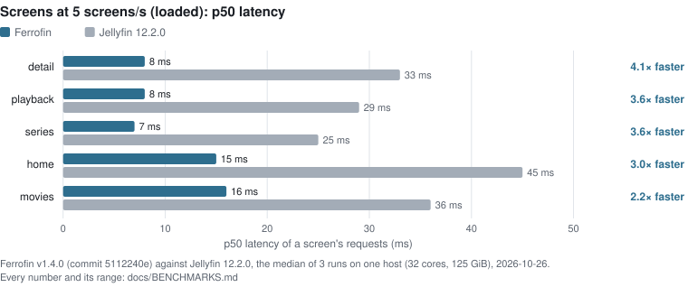
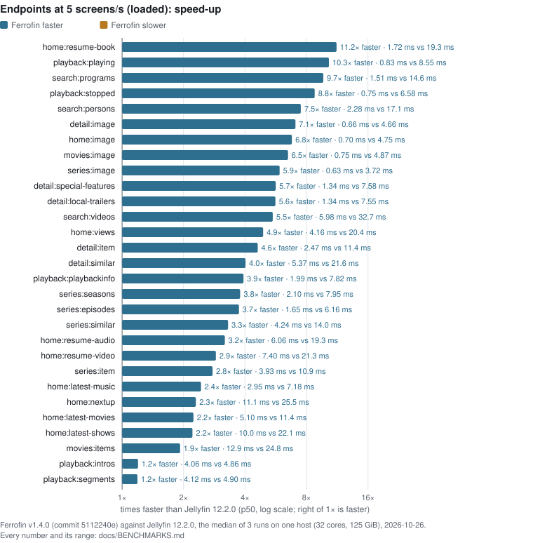
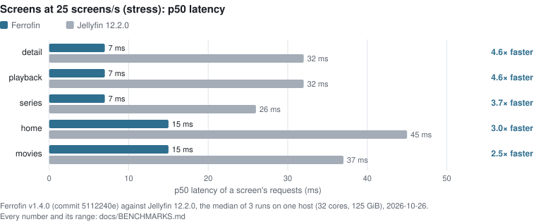
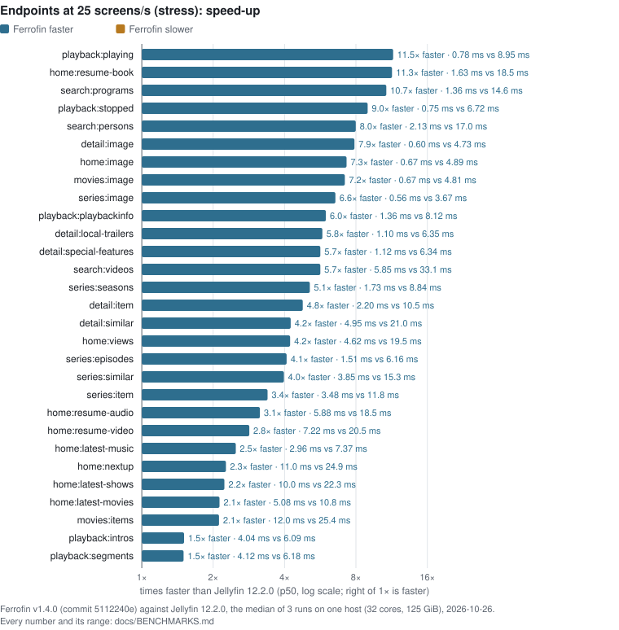
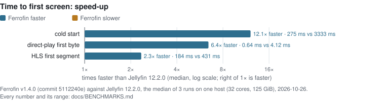
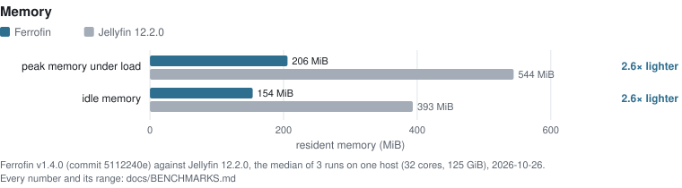
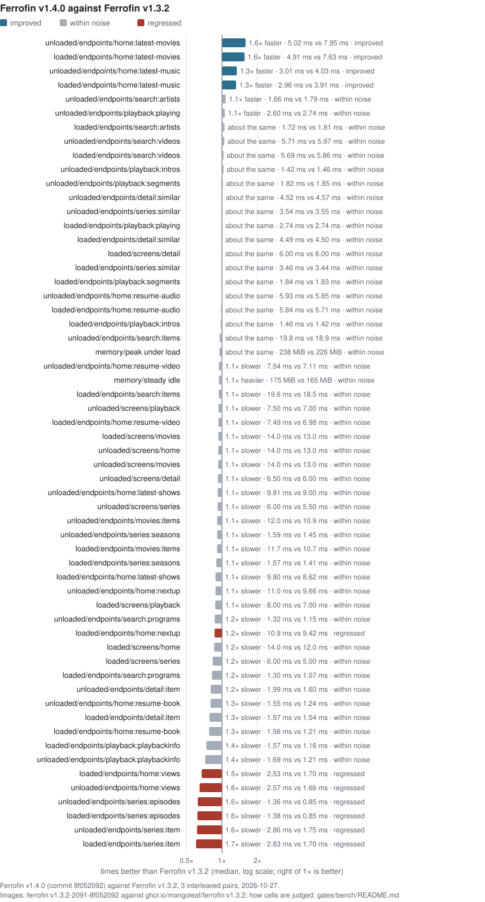
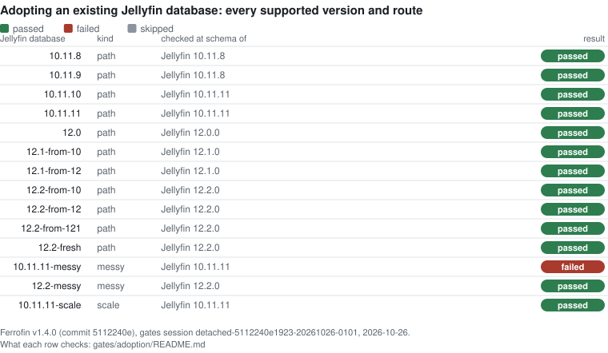
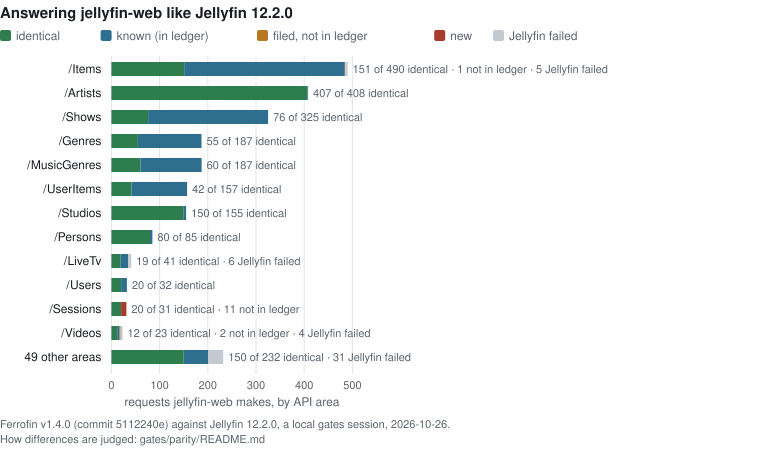
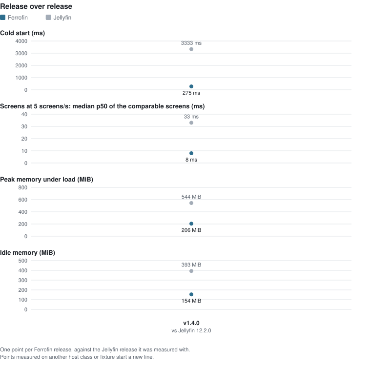

<div align="center">

# Ferrofin

**A drop-in Rust implementation of the Jellyfin media server.**

[](LICENSE)
[](rust-toolchain.toml)
[](docs/FEATURES.md)

[](https://github.com/mangoleaf/ferrofin/actions/workflows/ci.yml)
[](https://github.com/mangoleaf/ferrofin/releases)

</div>

Ferrofin speaks the **same HTTP API** as [Jellyfin](https://github.com/jellyfin/jellyfin), so
existing Jellyfin clients (the web UI and native TV/mobile apps such as Swiftfin, Findroid, and
Wolphin) connect to it **unchanged**. A client only ever sees an HTTP endpoint; it cannot tell
the server is Rust. Point Ferrofin at an existing Jellyfin database and it adopts it in place.

- **Want to try it?** → [Quickstart](#quickstart)
- **Coming from Jellyfin?** → [Migrating from Jellyfin](#migrating-from-jellyfin) (read the
  one-way warning first)
- **What actually works?** → [Feature status](docs/FEATURES.md)
- **Want to contribute?** → [CONTRIBUTING.md](CONTRIBUTING.md)

## Why Ferrofin

- **Measured against Jellyfin, every release.** Each release is measured against Jellyfin on the same
  machine and library: speed, time to first screen and memory, with every comparable cell graphed
  and the rest listed with the reason they are withheld. See [Results](#results).
- **One binary, no runtime.** A single `ferrofin-server` executable plus ffmpeg. No .NET
  runtime, no JIT warm-up. The Docker image bundles both jellyfin-ffmpeg and the jellyfin-web
  client, so `docker run` gives you the whole server, web UI included.
- **Drop-in compatible.** Same API contract, same on-disk database format (pinned to
  Jellyfin 12.0), same password hashes. Adopt an existing Jellyfin 10.11.8–10.11.11,
  12.0.0, 12.1.0, 12.2.0, 12.3.0 or 12.4.0 library with no re-scan; see [supported and tested versions](gates/adoption/README.md#supported-and-tested-versions).
- **Plugins cannot own your server.** Jellyfin loads plugins as full-trust .NET code inside
  the server process. Ferrofin does not, and will not. Third-party plugins run as
  sandboxed WASM with no filesystem or network access of their own. This is the one place
  Ferrofin deliberately diverges from Jellyfin; see [Plugins](#plugins-the-one-deliberate-divergence).
- **Every route ported** All 412 operations in the Jellyfin API contract are wired to
  working handlers, developed by cross-checking responses against a real Jellyfin server.
  No `501` stubs, no fake `200`s.

## About this project

Ferrofin began as a personal experiment in agentic engineering: a large Rust project taken from start to
release with AI agents writing most of the code and me, a software engineer of 15+ years,
steering the architecture, decisions, reviewing, and testing. I expect the first thing people will call
this is an "AI slop fork", and I understand the skepticism. I had a working server after two
days and could have released it then. Instead I spent the next six weeks using it as my home
media server, testing features, fixing performance issues and bugs, reshaping the architecture, adding tests and
gates, benchmarking, and closing the parity gap against Jellyfin. I fully intend to continue
using Ferrofin personally and to improve it over time.

I will not claim 100% parity with Jellyfin or that Ferrofin is bug free. At ~360k lines of
Rust there was more code than I could read, and the agents made questionable decisions at
times without asking. The performance gains over Jellyfin have been verified and the benchmarks back them
up, but there is still room for improvement.

Up until this first public release I have worked on Ferrofin solo. Most of my attention was on my 
personal definition of the golden path. Areas that could use more attention include Live TV and the large number of settings.
If something does not behave the way Jellyfin does, opening an issue describing the current and expected behaviour would be appreciated.
PRs or plugin development are welcome too if anyone wants to get involved!

## Results

<!-- BEGIN GENERATED RESULTS — do not edit by hand. Regenerate with: make publish-results (gates/publish.py) -->
### Speed and memory against Jellyfin

Ferrofin **v1.4.0** against **Jellyfin 12.2.0**: the median of 3 runs on one host (32 cores, 125 GiB), each server alone in its container, over the same library, 2026-10-26. Every comparable cell is drawn, the biggest speed-up first.

**12.1× faster cold start** · **2.2–4.1× the speed on 5 screens at 5 screens/s** · **2.6× lighter peak memory under load** · **2.6× lighter idle memory**

<picture>
  <source media="(prefers-color-scheme: dark)" srcset="docs/results/v1.4.0/screens-loaded-dark.svg">
  
</picture>

<details><summary>Screens at 5 screens/s (loaded): p50 latency: the numbers</summary>

| | Ferrofin | Jellyfin 12.2.0 | |
|---|---|---|---|
| detail | 8 ms | 33 ms | 4.1× faster |
| playback | 8 ms | 29 ms | 3.6× faster |
| series | 7 ms | 25 ms | 3.6× faster |
| home | 15 ms | 45 ms | 3.0× faster |
| movies | 16 ms | 36 ms | 2.2× faster |

</details>

<picture>
  <source media="(prefers-color-scheme: dark)" srcset="docs/results/v1.4.0/endpoints-loaded-dark.svg">
  
</picture>

<details><summary>Endpoints at 5 screens/s (loaded): speed-up: the numbers</summary>

| | Ferrofin | Jellyfin 12.2.0 | |
|---|---|---|---|
| home:resume-book | 1.72 ms | 19.3 ms | 11.2× faster |
| playback:playing | 0.83 ms | 8.55 ms | 10.3× faster |
| search:programs | 1.51 ms | 14.6 ms | 9.7× faster |
| playback:stopped | 0.75 ms | 6.58 ms | 8.8× faster |
| search:persons | 2.28 ms | 17.1 ms | 7.5× faster |
| detail:image | 0.66 ms | 4.66 ms | 7.1× faster |
| home:image | 0.70 ms | 4.75 ms | 6.8× faster |
| movies:image | 0.75 ms | 4.87 ms | 6.5× faster |
| series:image | 0.63 ms | 3.72 ms | 5.9× faster |
| detail:special-features | 1.34 ms | 7.58 ms | 5.7× faster |
| detail:local-trailers | 1.34 ms | 7.55 ms | 5.6× faster |
| search:videos | 5.98 ms | 32.7 ms | 5.5× faster |
| home:views | 4.16 ms | 20.4 ms | 4.9× faster |
| detail:item | 2.47 ms | 11.4 ms | 4.6× faster |
| detail:similar | 5.37 ms | 21.6 ms | 4.0× faster |
| playback:playbackinfo | 1.99 ms | 7.82 ms | 3.9× faster |
| series:seasons | 2.10 ms | 7.95 ms | 3.8× faster |
| series:episodes | 1.65 ms | 6.16 ms | 3.7× faster |
| series:similar | 4.24 ms | 14.0 ms | 3.3× faster |
| home:resume-audio | 6.06 ms | 19.3 ms | 3.2× faster |
| home:resume-video | 7.40 ms | 21.3 ms | 2.9× faster |
| series:item | 3.93 ms | 10.9 ms | 2.8× faster |
| home:latest-music | 2.95 ms | 7.18 ms | 2.4× faster |
| home:nextup | 11.1 ms | 25.5 ms | 2.3× faster |
| home:latest-movies | 5.10 ms | 11.4 ms | 2.2× faster |
| home:latest-shows | 10.0 ms | 22.1 ms | 2.2× faster |
| movies:items | 12.9 ms | 24.8 ms | 1.9× faster |
| playback:intros | 4.06 ms | 4.86 ms | 1.2× faster |
| playback:segments | 4.12 ms | 4.90 ms | 1.2× faster |

</details>

<picture>
  <source media="(prefers-color-scheme: dark)" srcset="docs/results/v1.4.0/screens-stress-dark.svg">
  
</picture>

<details><summary>Screens at 25 screens/s (stress): p50 latency: the numbers</summary>

| | Ferrofin | Jellyfin 12.2.0 | |
|---|---|---|---|
| detail | 7 ms | 32 ms | 4.6× faster |
| playback | 7 ms | 32 ms | 4.6× faster |
| series | 7 ms | 26 ms | 3.7× faster |
| home | 15 ms | 45 ms | 3.0× faster |
| movies | 15 ms | 37 ms | 2.5× faster |

</details>

<picture>
  <source media="(prefers-color-scheme: dark)" srcset="docs/results/v1.4.0/endpoints-stress-dark.svg">
  
</picture>

<details><summary>Endpoints at 25 screens/s (stress): speed-up: the numbers</summary>

| | Ferrofin | Jellyfin 12.2.0 | |
|---|---|---|---|
| playback:playing | 0.78 ms | 8.95 ms | 11.5× faster |
| home:resume-book | 1.63 ms | 18.5 ms | 11.3× faster |
| search:programs | 1.36 ms | 14.6 ms | 10.7× faster |
| playback:stopped | 0.75 ms | 6.72 ms | 9.0× faster |
| search:persons | 2.13 ms | 17.0 ms | 8.0× faster |
| detail:image | 0.60 ms | 4.73 ms | 7.9× faster |
| home:image | 0.67 ms | 4.89 ms | 7.3× faster |
| movies:image | 0.67 ms | 4.81 ms | 7.2× faster |
| series:image | 0.56 ms | 3.67 ms | 6.6× faster |
| playback:playbackinfo | 1.36 ms | 8.12 ms | 6.0× faster |
| detail:local-trailers | 1.10 ms | 6.35 ms | 5.8× faster |
| detail:special-features | 1.12 ms | 6.34 ms | 5.7× faster |
| search:videos | 5.85 ms | 33.1 ms | 5.7× faster |
| series:seasons | 1.73 ms | 8.84 ms | 5.1× faster |
| detail:item | 2.20 ms | 10.5 ms | 4.8× faster |
| detail:similar | 4.95 ms | 21.0 ms | 4.2× faster |
| home:views | 4.62 ms | 19.5 ms | 4.2× faster |
| series:episodes | 1.51 ms | 6.16 ms | 4.1× faster |
| series:similar | 3.85 ms | 15.3 ms | 4.0× faster |
| series:item | 3.48 ms | 11.8 ms | 3.4× faster |
| home:resume-audio | 5.88 ms | 18.5 ms | 3.1× faster |
| home:resume-video | 7.22 ms | 20.5 ms | 2.8× faster |
| home:latest-music | 2.96 ms | 7.37 ms | 2.5× faster |
| home:nextup | 11.0 ms | 24.9 ms | 2.3× faster |
| home:latest-shows | 10.0 ms | 22.3 ms | 2.2× faster |
| home:latest-movies | 5.08 ms | 10.8 ms | 2.1× faster |
| movies:items | 12.0 ms | 25.4 ms | 2.1× faster |
| playback:intros | 4.04 ms | 6.09 ms | 1.5× faster |
| playback:segments | 4.12 ms | 6.18 ms | 1.5× faster |

</details>

<picture>
  <source media="(prefers-color-scheme: dark)" srcset="docs/results/v1.4.0/startup-dark.svg">
  
</picture>

<details><summary>Time to first screen: speed-up: the numbers</summary>

| | Ferrofin | Jellyfin 12.2.0 | |
|---|---|---|---|
| cold start | 275 ms | 3333 ms | 12.1× faster |
| direct-play first byte | 0.64 ms | 4.12 ms | 6.4× faster |
| HLS first segment | 184 ms | 431 ms | 2.3× faster |

</details>

<picture>
  <source media="(prefers-color-scheme: dark)" srcset="docs/results/v1.4.0/memory-dark.svg">
  
</picture>

<details><summary>Memory: the numbers</summary>

| | Ferrofin | Jellyfin 12.2.0 | |
|---|---|---|---|
| peak memory under load | 206 MiB | 544 MiB | 2.6× lighter |
| idle memory | 154 MiB | 393 MiB | 2.6× lighter |

</details>

Withheld, because the servers did different work or the evidence is incomplete:

- loaded · screen · search: Ferrofin: search:artists: ids differs for a request pick
- loaded · endpoint · search:artists: Ferrofin: search:artists: ids differs for a request pick
- loaded · endpoint · search:image: Ferrofin: search:image: request picks differ
- loaded · endpoint · search:items: Ferrofin: search:items: ids differs for a request pick
- loaded · endpoint · image: Ferrofin: image: request picks differ
- stress · screen · search: Ferrofin: search:artists: ids differs for a request pick
- stress · endpoint · search:artists: Ferrofin: search:artists: ids differs for a request pick
- stress · endpoint · search:image: Ferrofin: search:image: request picks differ
- stress · endpoint · search:items: Ferrofin: search:items: ids differs for a request pick
- stress · endpoint · image: Ferrofin: image: request picks differ
- CPU per screen · unloaded level: Ferrofin: search:artists: ids differs for a request pick
- CPU per screen · loaded level: Ferrofin: search:artists: ids differs for a request pick
- CPU per screen · stress level: Ferrofin: search:artists: ids differs for a request pick

Source: detached-5112240e1923-20261026-0101/bench, detached-5112240e1923-20261026-0151/bench, detached-5112240e1923-20261026-0219/bench; commit `5112240e`, image `sha256:673a122ff717`, fixture `4b217db66afc`. The full tables are in [`docs/BENCHMARKS.md`](docs/BENCHMARKS.md); what each number means is in [`gates/bench/README.md`](gates/bench/README.md).

### Against the previous release

Ferrofin **v1.4.0** against **Ferrofin v1.3.2** (`ghcr.io/mangoleaf/ferrofin:v1.3.2`) in the release's A/B gate (3 interleaved pairs on one host, 2026-10-27): of 62 gated cells, **4 improved**, 47 are within noise and **7 regressed**, and 4 could not be compared (it blocks like a regression); **11 gated cells blocked the release**.

<picture>
  <source media="(prefers-color-scheme: dark)" srcset="docs/results/v1.4.0/previous-release-dark.svg">
  
</picture>

<details><summary>Against Ferrofin v1.3.2: every gated cell</summary>

| Cell | Previous | Candidate | Change | Verdict |
|---|---|---|---|---|
| loaded/endpoints/detail:item | 1.54 ms | 1.97 ms | +27.9% | within noise |
| loaded/endpoints/detail:similar | 4.50 ms | 4.49 ms | -0.1% | within noise |
| loaded/endpoints/home:latest-movies | 7.63 ms | 4.91 ms | -35.7% | improved |
| loaded/endpoints/home:latest-music | 3.91 ms | 2.96 ms | -24.1% | improved |
| loaded/endpoints/home:latest-shows | 8.62 ms | 9.80 ms | +13.8% | within noise |
| loaded/endpoints/home:nextup | 9.42 ms | 10.9 ms | +15.8% | regressed |
| loaded/endpoints/home:resume-audio | 5.71 ms | 5.84 ms | +2.2% | within noise |
| loaded/endpoints/home:resume-book | 1.21 ms | 1.56 ms | +28.8% | within noise |
| loaded/endpoints/home:resume-video | 6.98 ms | 7.49 ms | +7.2% | within noise |
| loaded/endpoints/home:views | 1.70 ms | 2.53 ms | +48.9% | regressed |
| loaded/endpoints/movies:items | 10.7 ms | 11.7 ms | +10.2% | within noise |
| loaded/endpoints/playback:intros | 1.42 ms | 1.46 ms | +2.6% | within noise |
| loaded/endpoints/playback:playbackinfo | 1.16 ms | 1.57 ms | +35.9% | within noise |
| loaded/endpoints/playback:playing | 2.74 ms | 2.74 ms | -0.1% | within noise |
| loaded/endpoints/playback:segments | 1.83 ms | 1.84 ms | +0.5% | within noise |
| loaded/endpoints/search:artists | 1.81 ms | 1.72 ms | -4.6% | within noise |
| loaded/endpoints/search:items | 18.5 ms | 19.6 ms | +6.3% | within noise |
| loaded/endpoints/search:persons | — | — | — | not comparable: responses differ from the baseline's |
| loaded/endpoints/search:programs | 1.07 ms | 1.30 ms | +21.8% | within noise |
| loaded/endpoints/search:videos | 5.86 ms | 5.69 ms | -2.9% | within noise |
| loaded/endpoints/series:episodes | 0.85 ms | 1.38 ms | +61.9% | regressed |
| loaded/endpoints/series:item | 1.70 ms | 2.83 ms | +66.4% | regressed |
| loaded/endpoints/series:seasons | 1.41 ms | 1.57 ms | +12.0% | within noise |
| loaded/endpoints/series:similar | 3.44 ms | 3.46 ms | +0.5% | within noise |
| loaded/screens/detail | 6.00 ms | 6.00 ms | +0.0% | within noise |
| loaded/screens/home | 12.0 ms | 14.0 ms | +16.7% | within noise |
| loaded/screens/movies | 13.0 ms | 14.0 ms | +7.7% | within noise |
| loaded/screens/playback | 7.00 ms | 8.00 ms | +14.3% | within noise |
| loaded/screens/search | — | — | — | not comparable: responses differ from the baseline's |
| loaded/screens/series | 5.00 ms | 6.00 ms | +20.0% | within noise |
| memory/peak under load | 226 MiB | 238 MiB | +5.1% | within noise |
| memory/steady idle | 165 MiB | 175 MiB | +6.2% | within noise |
| unloaded/endpoints/detail:item | 1.60 ms | 1.99 ms | +24.8% | within noise |
| unloaded/endpoints/detail:similar | 4.57 ms | 4.52 ms | -1.2% | within noise |
| unloaded/endpoints/home:latest-movies | 7.95 ms | 5.02 ms | -36.9% | improved |
| unloaded/endpoints/home:latest-music | 4.03 ms | 3.01 ms | -25.3% | improved |
| unloaded/endpoints/home:latest-shows | 9.00 ms | 9.81 ms | +9.0% | within noise |
| unloaded/endpoints/home:nextup | 9.66 ms | 11.0 ms | +13.8% | within noise |
| unloaded/endpoints/home:resume-audio | 5.85 ms | 5.93 ms | +1.3% | within noise |
| unloaded/endpoints/home:resume-book | 1.24 ms | 1.55 ms | +25.2% | within noise |
| unloaded/endpoints/home:resume-video | 7.11 ms | 7.54 ms | +6.1% | within noise |
| unloaded/endpoints/home:views | 1.66 ms | 2.57 ms | +55.3% | regressed |
| unloaded/endpoints/movies:items | 10.9 ms | 12.0 ms | +10.1% | within noise |
| unloaded/endpoints/playback:intros | 1.46 ms | 1.42 ms | -2.8% | within noise |
| unloaded/endpoints/playback:playbackinfo | 1.21 ms | 1.69 ms | +39.0% | within noise |
| unloaded/endpoints/playback:playing | 2.74 ms | 2.60 ms | -5.2% | within noise |
| unloaded/endpoints/playback:segments | 1.85 ms | 1.82 ms | -1.6% | within noise |
| unloaded/endpoints/search:artists | 1.79 ms | 1.66 ms | -6.9% | within noise |
| unloaded/endpoints/search:items | 18.9 ms | 19.8 ms | +4.6% | within noise |
| unloaded/endpoints/search:persons | — | — | — | not comparable: responses differ from the baseline's |
| unloaded/endpoints/search:programs | 1.15 ms | 1.32 ms | +15.4% | within noise |
| unloaded/endpoints/search:videos | 5.97 ms | 5.71 ms | -4.3% | within noise |
| unloaded/endpoints/series:episodes | 0.85 ms | 1.36 ms | +60.5% | regressed |
| unloaded/endpoints/series:item | 1.75 ms | 2.86 ms | +63.1% | regressed |
| unloaded/endpoints/series:seasons | 1.45 ms | 1.59 ms | +10.2% | within noise |
| unloaded/endpoints/series:similar | 3.55 ms | 3.54 ms | -0.3% | within noise |
| unloaded/screens/detail | 6.00 ms | 6.50 ms | +8.3% | within noise |
| unloaded/screens/home | 13.0 ms | 14.0 ms | +7.7% | within noise |
| unloaded/screens/movies | 13.0 ms | 14.0 ms | +7.7% | within noise |
| unloaded/screens/playback | 7.00 ms | 7.50 ms | +7.1% | within noise |
| unloaded/screens/search | — | — | — | not comparable: responses differ from the baseline's |
| unloaded/screens/series | 5.50 ms | 6.00 ms | +9.1% | within noise |

</details>

### Adopting an existing Jellyfin database

Each supported Jellyfin version and upgrade route, adopted in place by Ferrofin **v1.4.0** (commit `5112240e1923`) in a local gates session on 2026-10-26: **13 of 14 passed**. Adoption is one-way; see [Migrating from Jellyfin](#migrating-from-jellyfin).

<picture>
  <source media="(prefers-color-scheme: dark)" srcset="docs/results/v1.4.0/adoption-dark.svg">
  
</picture>

<details><summary>Adoption: every row</summary>

| Jellyfin database | Kind | Checked at | Result | Why |
|---|---|---|---|---|
| jellyfin-10.11.8 | path | 10.11.8 | passed |  |
| jellyfin-10.11.9 | path | 10.11.8 | passed |  |
| jellyfin-10.11.10 | path | 10.11.11 | passed |  |
| jellyfin-10.11.11 | path | 10.11.11 | passed |  |
| jellyfin-12.0 | path | 12.0.0 | passed |  |
| jellyfin-12.1-from-10 | path | 12.1.0 | passed |  |
| jellyfin-12.1-from-12 | path | 12.1.0 | passed |  |
| jellyfin-12.2-from-10 | path | 12.2.0 | passed |  |
| jellyfin-12.2-from-12 | path | 12.2.0 | passed |  |
| jellyfin-12.2-from-121 | path | 12.2.0 | passed |  |
| jellyfin-12.2-fresh | path | 12.2.0 | passed |  |
| jellyfin-10.11.11-messy | messy | 10.11.11 | failed | messy: gone_file_userdata: {'item': True, 'userdata_on_item': 2, 'userdata_with_key': 2}, expected {'item': False, 'userdata_on_item': 0, 'userdata_with_key': 2} (Jellyfin 12.2);after restart: messy:  |
| jellyfin-12.2-messy | messy | 12.2.0 | passed |  |
| jellyfin-10.11.11-scale | scale | 10.11.11 | passed |  |

</details>

### Answering like Jellyfin

The parity gate replays the **2,353** requests jellyfin-web makes against Jellyfin 12.2.0 and Ferrofin **v1.4.0** (commit `5112240e`, a local gates session on 2026-10-26) and compares the answers. Of the 2,307 it could compare, **1,242 are identical** and **1,051 differ in accepted ways** (each recorded with its reason in the parity ledger); **2 are filed as issues** and **12 are new**. 46 were not compared because Jellyfin itself failed them.

<picture>
  <source media="(prefers-color-scheme: dark)" srcset="docs/results/v1.4.0/parity-dark.svg">
  
</picture>

<details><summary>Parity: every API area</summary>

| Area | Requests | Identical | Accepted | Filed | New | Not compared |
|---|---|---|---|---|---|---|
| /Items | 490 | 151 | 333 | 0 | 1 | 5 |
| /Artists | 408 | 407 | 1 | 0 | 0 | 0 |
| /Shows | 325 | 76 | 249 | 0 | 0 | 0 |
| /Genres | 187 | 55 | 132 | 0 | 0 | 0 |
| /MusicGenres | 187 | 60 | 127 | 0 | 0 | 0 |
| /UserItems | 157 | 42 | 115 | 0 | 0 | 0 |
| /Studios | 155 | 150 | 5 | 0 | 0 | 0 |
| /Persons | 85 | 80 | 5 | 0 | 0 | 0 |
| /LiveTv | 41 | 19 | 16 | 0 | 0 | 6 |
| /Users | 32 | 20 | 12 | 0 | 0 | 0 |
| /Sessions | 31 | 20 | 0 | 0 | 11 | 0 |
| /Videos | 23 | 12 | 5 | 2 | 0 | 4 |
| /SyncPlay | 22 | 21 | 1 | 0 | 0 | 0 |
| /Playlists | 19 | 18 | 1 | 0 | 0 | 0 |
| /Audio | 17 | 10 | 4 | 0 | 0 | 3 |
| /Library | 17 | 15 | 2 | 0 | 0 | 0 |
| /System | 17 | 12 | 5 | 0 | 0 | 0 |
| /Plugins | 9 | 0 | 9 | 0 | 0 | 0 |
| /Intros | 8 | 0 | 0 | 0 | 0 | 8 |
| /Auth | 7 | 7 | 0 | 0 | 0 | 0 |
| /Startup | 7 | 6 | 1 | 0 | 0 | 0 |
| /Branding | 6 | 5 | 1 | 0 | 0 | 0 |
| /Collections | 6 | 6 | 0 | 0 | 0 | 0 |
| /Environment | 6 | 5 | 0 | 0 | 0 | 1 |
| /ScheduledTasks | 6 | 4 | 1 | 0 | 0 | 1 |
| /Channels | 5 | 3 | 2 | 0 | 0 | 0 |
| /Devices | 5 | 4 | 1 | 0 | 0 | 0 |
| /Backup | 4 | 1 | 3 | 0 | 0 | 0 |
| /Localization | 4 | 4 | 0 | 0 | 0 | 0 |
| /MergeVersions | 4 | 0 | 0 | 0 | 0 | 4 |
| /Packages | 4 | 1 | 3 | 0 | 0 | 0 |
| /QuickConnect | 4 | 2 | 2 | 0 | 0 | 0 |
| /UserImage | 4 | 2 | 2 | 0 | 0 | 0 |
| /Episode | 3 | 0 | 0 | 0 | 0 | 3 |
| /MediaSegmentsApi | 3 | 0 | 0 | 0 | 0 | 3 |
| /PlayingItems | 3 | 3 | 0 | 0 | 0 | 0 |
| /UserViews | 3 | 1 | 2 | 0 | 0 | 0 |
| /Albums | 2 | 2 | 0 | 0 | 0 | 0 |
| /DisplayPreferences | 2 | 2 | 0 | 0 | 0 | 0 |
| /FallbackFont | 2 | 2 | 0 | 0 | 0 | 0 |
| /IntroSkipper | 2 | 0 | 0 | 0 | 0 | 2 |
| /LiveStreams | 2 | 1 | 1 | 0 | 0 | 0 |
| /MediaSegments | 2 | 2 | 0 | 0 | 0 | 0 |
| /Movies | 2 | 1 | 1 | 0 | 0 | 0 |
| /Providers | 2 | 0 | 1 | 0 | 0 | 1 |
| /Repositories | 2 | 2 | 0 | 0 | 0 | 0 |
| /SkipButtonCss | 2 | 0 | 0 | 0 | 0 | 2 |
| /Trailers | 2 | 0 | 1 | 0 | 0 | 1 |
| /UserFavoriteItems | 2 | 2 | 0 | 0 | 0 | 0 |
| /UserPlayedItems | 2 | 2 | 0 | 0 | 0 | 0 |
| /Years | 2 | 0 | 2 | 0 | 0 | 0 |
| /web | 2 | 0 | 2 | 0 | 0 | 0 |
| /ClientLog | 1 | 1 | 0 | 0 | 0 | 0 |
| /FileTransformation | 1 | 0 | 0 | 0 | 0 | 1 |
| /GetUtcTime | 1 | 1 | 0 | 0 | 0 | 0 |
| /Jellyfin.Plugin.OpenSubtitles | 1 | 0 | 0 | 0 | 0 | 1 |
| /Libraries | 1 | 0 | 1 | 0 | 0 | 0 |
| /Playback | 1 | 0 | 1 | 0 | 0 | 0 |
| /Search | 1 | 0 | 1 | 0 | 0 | 0 |
| /Songs | 1 | 1 | 0 | 0 | 0 | 0 |
| /Tmdb | 1 | 1 | 0 | 0 | 0 | 0 |

Filed as issues: gl-832, gl-860.

</details>

### Release over release

The same headline numbers for every release published so far (v1.4.0), each against the Jellyfin release it was measured with. Only releases measured on the same host class and fixture are joined by a line.

<picture>
  <source media="(prefers-color-scheme: dark)" srcset="docs/results/history-dark.svg">
  
</picture>

<!-- END GENERATED RESULTS -->


## Quickstart

**Docker** (the release image bundles ffmpeg and the jellyfin-web client at `/web`):

```sh
docker run -d --name ferrofin \
  -p 8096:8096 \
  -v ferrofin-data:/data \
  -v /path/to/media:/media:ro \
  ghcr.io/mangoleaf/ferrofin:latest
```

For automatic LAN server discovery, see [server discovery deployment](docs/SERVER_DISCOVERY.md).
The TCP mapping above supports manual URL connections; it does not forward discovery broadcasts.

**Helm** (the chart is published as an OCI artifact next to the image):

```sh
helm install ferrofin oci://ghcr.io/mangoleaf/ferrofin/charts/ferrofin -n ferrofin --create-namespace
```

See [`charts/ferrofin/README.md`](charts/ferrofin/README.md) and
[`values.example.yaml`](charts/ferrofin/values.example.yaml) for a worked configuration.

**Debian/Ubuntu package** (depends on `jellyfin-ffmpeg8` and `jellyfin-web` from Jellyfin's
apt repository, ships a systemd unit): add the repository, then
`apt-get install ./ferrofin_<version>_<arch>.deb` from the releases page. The full walk-through,
including the plain release tarball, is [`docs/INSTALL.md`](docs/INSTALL.md).

**From source** (needs the pinned Rust toolchain; ffmpeg is optional and its absence only
disables transcoding):

```sh
cargo run -p ferrofin-server -- --data-dir ./data --bind 127.0.0.1 --port 8096
```

On a fresh database Ferrofin seeds an `admin` user **with no password**, as Jellyfin does,
and logs a warning: the setup wizard at `/web` sets the password. Until it does, anyone who
can reach the server can sign in as that administrator, so keep it bound to loopback (or,
for the container image, which listens on all interfaces, keep its port unpublished) until
setup is done, or set `FERROFIN_ADMIN_PASSWORD` to seed the password for a headless
install. Then:

```sh
curl http://localhost:8096/System/Info/Public   # smoke test
# open http://localhost:8096/web, or point a native Jellyfin client at the server
```

Configuration is via CLI flags, `FERROFIN_*` environment variables, or
`{data_dir}/config.toml`, in that order of precedence. The full surface is in
[`docs/CONFIG.md`](docs/CONFIG.md).

## Migrating from Jellyfin

Ferrofin reads Jellyfin's database directly. Point it at a data directory containing a
Jellyfin **10.11.8, 10.11.9, 10.11.10, 10.11.11, 12.0.0, 12.1.0, 12.2.0, 12.3.0 or 12.4.0** `jellyfin.db` and on first boot it detects the database,
validates its migration set (and refuses loudly rather than half-adopting an unexpected version), and
adopts it in place: **no re-scan, no re-import**. Users, watch state, playlists, and Live TV
configuration carry forward. Ferrofin retains the `Users.NormalizedUsername` column and
unique index from Jellyfin 10.11.10/10.11.11 and adds them to older databases. Login,
creation, and renaming use Unicode-aware invariant uppercase keys compatible with
Jellyfin, while the original spelling remains visible. If existing usernames collide
under these rules, startup stops with the conflicting account IDs and names; resolve
the names in the original server before retrying. Accounts are never merged.

Every release's gates session adopts each supported version and upgrade route, and the latest
release's status is in [Results](#adopting-an-existing-jellyfin-database). Checks cover API
summaries against the latest Jellyfin release (12.4), database integrity, and stable responses without repeated
repairs after restart. See the [support matrix and tested build](gates/adoption/README.md#supported-and-tested-versions).
Support is determined by the exact migration history; these version numbers do not imply
support for every 10.11.x or 12.x release.

> ### ⚠ Migration is one-way. Back up first.
>
> Adopting the database runs Ferrofin's own migrations on it. Some of those rebuild
> Jellyfin's tables and normalise stored values, so the result is a Ferrofin database that
> Jellyfin is **not** guaranteed to open again. Ferrofin writes a copy of the original to
> `jellyfin.db.pre-ferrofin` before it touches anything and logs the path, but do not rely
> on that alone:
>
> 1. Stop both Jellyfin and Ferrofin.
> 2. **Back up the whole Jellyfin data directory and all configuration files**, including
>    hidden files and database `-wal`/`-shm` companions if present. Configuration may live
>    separately, for example in `/etc/jellyfin` on Debian. Include any external state
>    directories too.
> 3. Copy Jellyfin's `data/jellyfin.db`, `data/playlists/`, `data/collections/`,
>    `root/default/` and `metadata/` to the same relative paths under Ferrofin's data
>    directory, and its XML configuration into Ferrofin's config directory, **before
>    Ferrofin's first startup**. [`scripts/migrate-jellyfin.sh`](scripts/migrate-jellyfin.sh)
>    does this for the Debian layout. Keep the originals and backup intact. An existing
>    `ferrofin.db` or Ferrofin JSON configuration takes precedence over copied Jellyfin
>    files.
>
> `root/default/` holds the library definitions and `metadata/` the images. On first start
> Ferrofin imports the supported settings from `system.xml`, `encoding.xml`, `branding.xml`
> and `network.xml` into JSON, once; omitting `network.xml` discards remote-access
> restrictions and IP filters. Verify the imported settings and investigate import
> warnings before exposing the server. Jellyfin .NET plugins are not copied and need
> Ferrofin-compatible replacements.
>
> Follow the [migration procedure](docs/INSTALL.md#migrate-an-existing-jellyfin-installation)
> for copying, startup verification, and rollback.
>
> If you decide to go back to Jellyfin, restore that backup. Anything that happened in
> Ferrofin after the switch (watch state, new users, playlists) stays in Ferrofin.

Existing Ferrofin databases upgrade in place across releases; steps that need operator
action are listed in [`docs/UPGRADING.md`](docs/UPGRADING.md).

## Plugins: the one deliberate divergence

Everything else in Ferrofin aims at parity with Jellyfin. Plugins are where it breaks
rank, on purpose.

**Jellyfin's model:** a plugin is a .NET assembly loaded into the server process with the
server's full privileges. Any plugin you install can read every file the server can,
open any network connection, and take the server down with it when it crashes. You are
trusting the plugin author with your machine.

**Ferrofin's model:** third-party code never runs with the server's privileges. There are
two tiers, and no third:

- **Compiled-in extensions** are Jellyfin plugins ported into this repository, reviewed
  like any other code and shipped inside the binary. They get full power *because* they
  went through review. Intro Skipper, File Transformation, and Merge Versions are ported
  today. They surface through the normal `/Plugins` API: dashboard entries, settings pages,
  enable/disable.
- **Sandboxed WASM plugins** are how code this repository has never seen gets installed:
  drop a `.wasm` component into `{data_dir}/plugins/` (or install from a configured plugin
  repository over HTTPS, checksum-verified) and restart. A WASM plugin runs with **no
  filesystem access, no network sockets, and no view of server memory**. Its whole world
  is a short, reviewable list of capabilities Ferrofin explicitly exports: logging, its own
  settings, host-mediated HTTP, read-only library queries, and writing its own media
  segments. Memory and CPU time are capped per plugin; one that misbehaves is interrupted
  and disabled while the server keeps serving. One artifact runs on every platform, and
  plugins can be written in any language that targets the WASM component model.

Be precise about what the sandbox does *not* remove: a plugin acting as a metadata source
can read your library's catalogue (titles, ids, file paths) and can ask Ferrofin to make
outbound HTTP requests on its behalf (destinations logged, bodies bounded, private and
loopback addresses refused unless you allowlist the plugin). So an actively malicious
plugin could still ship your movie list somewhere, and you should install plugins you have
some reason to trust. What it removes is the catastrophic tail every full-trust plugin
system carries: file access, raw sockets, and the run-anything blast radius.

Rust has no stable ABI, so a .NET-style native loader was never on the table, but that is
not why the design is this way. Ferrofin will not load untrusted native code into the
server process. Details and the capability list are in
**[`docs/EXTENSIONS.md`](docs/EXTENSIONS.md)**. To write one, clone
[`ferrofin-plugin-template`](https://github.com/mangoleaf/ferrofin-plugin-template): the
toolchain, target and contract bindings are already wired, and its CI publishes a plugin
repository you can add to a server to install it from the dashboard.

## Feature status

All 412 operations in the vendored Jellyfin 10.11.8 contract are implemented. Working
end-to-end: authentication, users and QuickConnect; library scan with live filesystem
watching; browse and query; images; sessions, playstate and remote control; WebSocket push;
playlists and collections; direct play and live HLS transcoding (NVENC, VAAPI and QSV
hardware paths); Live TV with M3U/XMLTV and DVR; SyncPlay; 20 scheduled tasks;
metrics and tracing; trickplay, chapters, lyrics and media segments; photo and book
libraries; backup and restore.

Not implemented, by design: .NET-style native plugin loading (see above), DLNA server
discovery (SSDP), and the AMF, VideoToolbox, RKMPP and V4L2M2M hardware transcode paths
(unverifiable without the hardware; selecting one falls back to software with a logged
warning). Remote metadata providers (TMDB, TVDB, MusicBrainz, TheAudioDB, fanart) are on
by default and gated per library exactly as in Jellyfin, including OMDb. Shared
provider keys are built in; operator keys are optional overrides.

The tiered matrix with verification depth per area is
**[`docs/FEATURES.md`](docs/FEATURES.md)**.

## Observability

Ferrofin is built to be run under a modern monitoring stack, not tailed in a terminal.

- **Structured JSON logs** on stdout by default, one event per line with a level, target
  and typed fields (`item_id`, `user_id`, `task`, …). Set `FERROFIN_LOG_FORMAT=text` for
  the human-readable form when running interactively; `FERROFIN_LOG` takes the usual
  `RUST_LOG` filter syntax.
- **Prometheus metrics** at `/metrics` when `FERROFIN_ENABLE_METRICS=true`, using
  Jellyfin's own metric names (`http_*`, `process_*`) so existing dashboards keep
  working. Two ready-made Grafana dashboards and a scrape config are in
  [`contrib/metrics/`](contrib/metrics/).
- **OpenTelemetry traces** over OTLP: set `OTEL_EXPORTER_OTLP_ENDPOINT` and every request,
  library scan, transcode and scheduled task becomes a span. Off unless that variable is
  set; sampling is the storage knob.

Conventions for each are in [`docs/conventions/`](docs/conventions/).

## Architecture

A Rust workspace of about twenty crates, edition 2024. The load-bearing idea: clients
depend on Jellyfin's **API surface**, not its code, so the contract is the vendored
OpenAPI spec and everything behind it is designed idiomatically in Rust (traits as the
dependency-injection seam, no ported OOP object hierarchy, runtime sqlx on SQLite).

```
util ─┐
model ┼─ common ─┬─ db ──────┐
naming┘          │            │
keyframes        networking   ├─ traits ─┬─ mediaencoding ─ hls
chromaprint      health       │          ├─ drawing
                 metrics      │          ├─ providers
                              │          ├─ livetv
                              │          ├─ extensions
                              │          └─ wasm (plugin host)
                              └──────────────► core ─► api ─► server (bin)
```

Crate map, the C#-to-Rust mapping, and the porting rules: [`docs/ARCHITECTURE.md`](docs/ARCHITECTURE.md).

## Contributing

Every change is gated behind `cargo fmt`, `clippy -D warnings`, the full test suite, and
an 80 % per-crate line-coverage floor. Performance and memory are benchmarked before each
release.
See [`CONTRIBUTING.md`](CONTRIBUTING.md); the deeper operating guide is [`CLAUDE.md`](CLAUDE.md).

Security policy: [`SECURITY.md`](SECURITY.md). Changelog: [`CHANGELOG.md`](CHANGELOG.md).
Releasing: [`RELEASE.md`](RELEASE.md).

## License

**GPL-3.0-only.** Ferrofin is a source-level derivative of Jellyfin. The Jellyfin repository
is internally inconsistent on this point (the root `LICENSE` is GPL-2.0, but the library
`.csproj` packages being ported declare `GPL-3.0-only`); Ferrofin follows the
`GPL-3.0-only` metadata on the specific crates it derives from. See [`LICENSE`](LICENSE).
