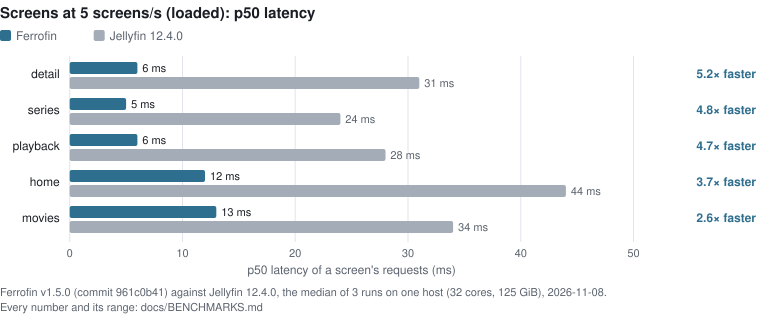
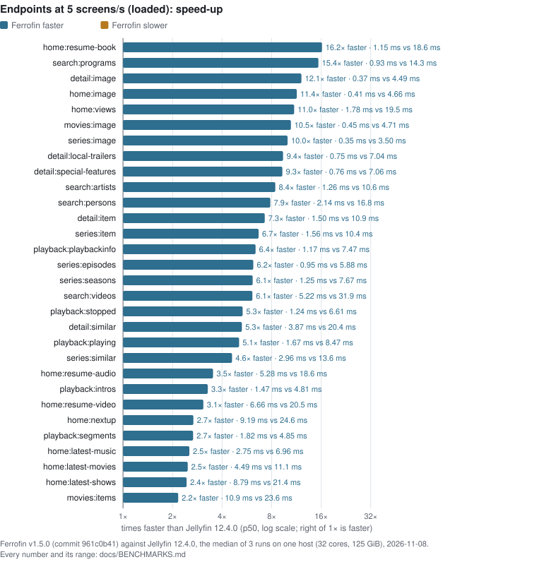
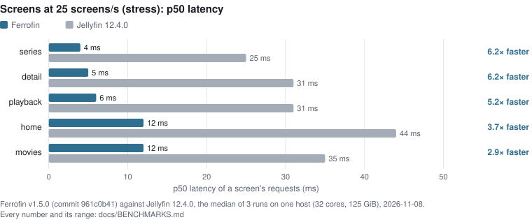
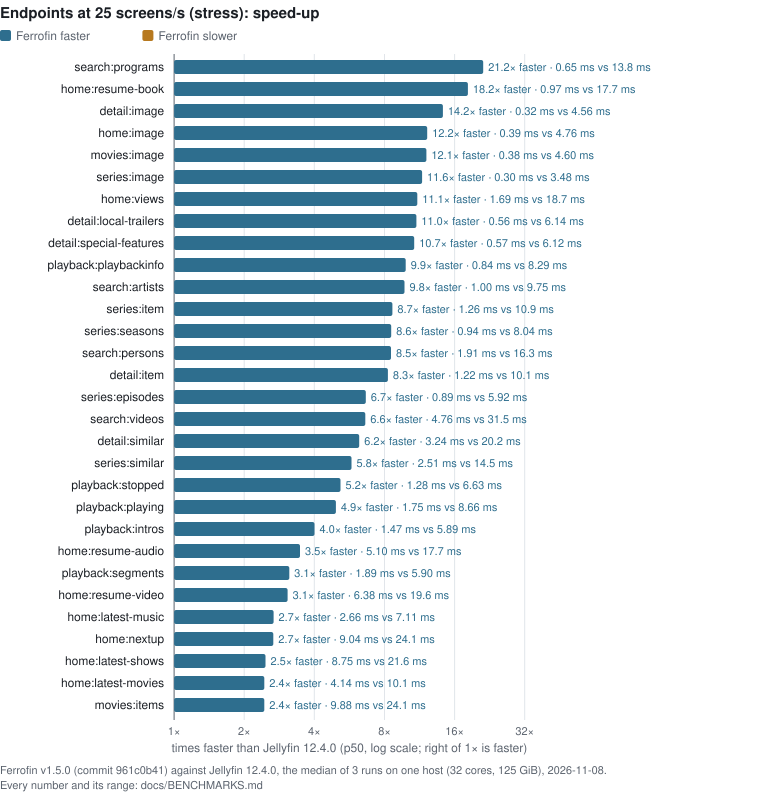
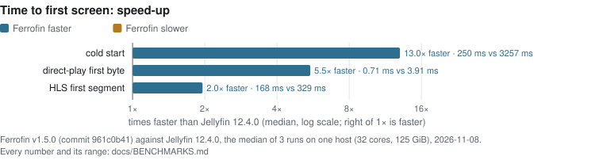
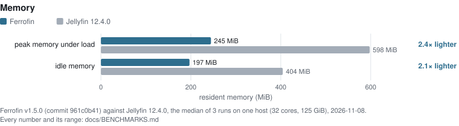
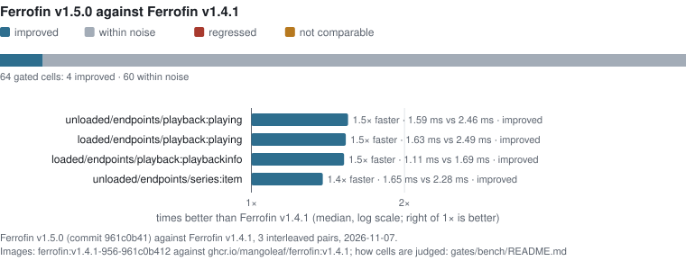
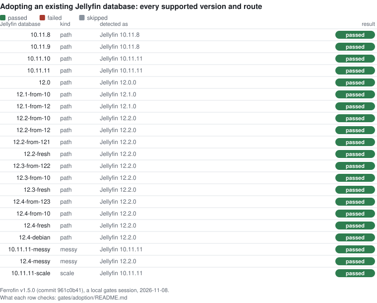
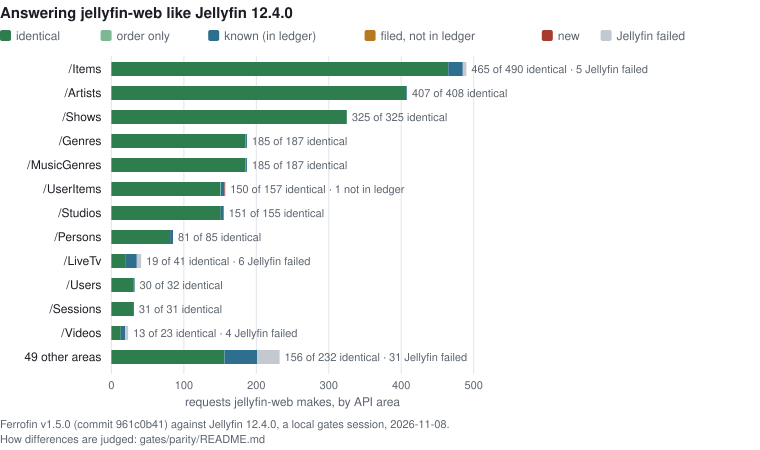

<!-- Generated by gates/publish.py (make publish-results): do not edit by hand. -->

# Ferrofin v1.5.0 against Jellyfin 12.4.0

Every graph and table of the v1.5.0 results; the summary is in the [README](../../../README.md#results).

## Speed and memory against Jellyfin

Ferrofin **v1.5.0** against **Jellyfin 12.4.0**: the median of 3 runs on one host (32 cores, 125 GiB), each server alone in its container, over the same library (3,001 movies, 250 series, 7,490 episodes, 50 HDR videos), 2026-11-08. One host and one library: other hardware and libraries give other numbers. Every comparable cell is drawn, the biggest speed-up first.

**13.0× faster cold start** · **2.6–5.2× the speed on 5 screens at 5 screens/s** · **2.4× lighter peak memory under load** · **2.1× lighter idle memory**

<picture>
  <source media="(prefers-color-scheme: dark)" srcset="./screens-loaded-dark.svg">
  
</picture>

Screens at 5 screens/s (loaded): p50 latency: the numbers

| | Ferrofin | Jellyfin 12.4.0 | |
|---|---|---|---|
| detail | 6 ms | 31 ms | 5.2× faster |
| series | 5 ms | 24 ms | 4.8× faster |
| playback | 6 ms | 28 ms | 4.7× faster |
| home | 12 ms | 44 ms | 3.7× faster |
| movies | 13 ms | 34 ms | 2.6× faster |

<picture>
  <source media="(prefers-color-scheme: dark)" srcset="./endpoints-loaded-dark.svg">
  
</picture>

Endpoints at 5 screens/s (loaded): speed-up: the numbers

| | Ferrofin | Jellyfin 12.4.0 | |
|---|---|---|---|
| home:resume-book | 1.15 ms | 18.6 ms | 16.2× faster |
| search:programs | 0.93 ms | 14.3 ms | 15.4× faster |
| detail:image | 0.37 ms | 4.49 ms | 12.1× faster |
| home:image | 0.41 ms | 4.66 ms | 11.4× faster |
| home:views | 1.78 ms | 19.5 ms | 11.0× faster |
| movies:image | 0.45 ms | 4.71 ms | 10.5× faster |
| series:image | 0.35 ms | 3.50 ms | 10.0× faster |
| detail:local-trailers | 0.75 ms | 7.04 ms | 9.4× faster |
| detail:special-features | 0.76 ms | 7.06 ms | 9.3× faster |
| search:artists | 1.26 ms | 10.6 ms | 8.4× faster |
| search:persons | 2.14 ms | 16.8 ms | 7.9× faster |
| detail:item | 1.50 ms | 10.9 ms | 7.3× faster |
| series:item | 1.56 ms | 10.4 ms | 6.7× faster |
| playback:playbackinfo | 1.17 ms | 7.47 ms | 6.4× faster |
| series:episodes | 0.95 ms | 5.88 ms | 6.2× faster |
| series:seasons | 1.25 ms | 7.67 ms | 6.1× faster |
| search:videos | 5.22 ms | 31.9 ms | 6.1× faster |
| playback:stopped | 1.24 ms | 6.61 ms | 5.3× faster |
| detail:similar | 3.87 ms | 20.4 ms | 5.3× faster |
| playback:playing | 1.67 ms | 8.47 ms | 5.1× faster |
| series:similar | 2.96 ms | 13.6 ms | 4.6× faster |
| home:resume-audio | 5.28 ms | 18.6 ms | 3.5× faster |
| playback:intros | 1.47 ms | 4.81 ms | 3.3× faster |
| home:resume-video | 6.66 ms | 20.5 ms | 3.1× faster |
| home:nextup | 9.19 ms | 24.6 ms | 2.7× faster |
| playback:segments | 1.82 ms | 4.85 ms | 2.7× faster |
| home:latest-music | 2.75 ms | 6.96 ms | 2.5× faster |
| home:latest-movies | 4.49 ms | 11.1 ms | 2.5× faster |
| home:latest-shows | 8.79 ms | 21.4 ms | 2.4× faster |
| movies:items | 10.9 ms | 23.6 ms | 2.2× faster |

<picture>
  <source media="(prefers-color-scheme: dark)" srcset="./screens-stress-dark.svg">
  
</picture>

Screens at 25 screens/s (stress): p50 latency: the numbers

| | Ferrofin | Jellyfin 12.4.0 | |
|---|---|---|---|
| series | 4 ms | 25 ms | 6.2× faster |
| detail | 5 ms | 31 ms | 6.2× faster |
| playback | 6 ms | 31 ms | 5.2× faster |
| home | 12 ms | 44 ms | 3.7× faster |
| movies | 12 ms | 35 ms | 2.9× faster |

<picture>
  <source media="(prefers-color-scheme: dark)" srcset="./endpoints-stress-dark.svg">
  
</picture>

Endpoints at 25 screens/s (stress): speed-up: the numbers

| | Ferrofin | Jellyfin 12.4.0 | |
|---|---|---|---|
| search:programs | 0.65 ms | 13.8 ms | 21.2× faster |
| home:resume-book | 0.97 ms | 17.7 ms | 18.2× faster |
| detail:image | 0.32 ms | 4.56 ms | 14.2× faster |
| home:image | 0.39 ms | 4.76 ms | 12.2× faster |
| movies:image | 0.38 ms | 4.60 ms | 12.1× faster |
| series:image | 0.30 ms | 3.48 ms | 11.6× faster |
| home:views | 1.69 ms | 18.7 ms | 11.1× faster |
| detail:local-trailers | 0.56 ms | 6.14 ms | 11.0× faster |
| detail:special-features | 0.57 ms | 6.12 ms | 10.7× faster |
| playback:playbackinfo | 0.84 ms | 8.29 ms | 9.9× faster |
| search:artists | 1.00 ms | 9.75 ms | 9.8× faster |
| series:item | 1.26 ms | 10.9 ms | 8.7× faster |
| series:seasons | 0.94 ms | 8.04 ms | 8.6× faster |
| search:persons | 1.91 ms | 16.3 ms | 8.5× faster |
| detail:item | 1.22 ms | 10.1 ms | 8.3× faster |
| series:episodes | 0.89 ms | 5.92 ms | 6.7× faster |
| search:videos | 4.76 ms | 31.5 ms | 6.6× faster |
| detail:similar | 3.24 ms | 20.2 ms | 6.2× faster |
| series:similar | 2.51 ms | 14.5 ms | 5.8× faster |
| playback:stopped | 1.28 ms | 6.63 ms | 5.2× faster |
| playback:playing | 1.75 ms | 8.66 ms | 4.9× faster |
| playback:intros | 1.47 ms | 5.89 ms | 4.0× faster |
| home:resume-audio | 5.10 ms | 17.7 ms | 3.5× faster |
| playback:segments | 1.89 ms | 5.90 ms | 3.1× faster |
| home:resume-video | 6.38 ms | 19.6 ms | 3.1× faster |
| home:latest-music | 2.66 ms | 7.11 ms | 2.7× faster |
| home:nextup | 9.04 ms | 24.1 ms | 2.7× faster |
| home:latest-shows | 8.75 ms | 21.6 ms | 2.5× faster |
| home:latest-movies | 4.14 ms | 10.1 ms | 2.4× faster |
| movies:items | 9.88 ms | 24.1 ms | 2.4× faster |

<picture>
  <source media="(prefers-color-scheme: dark)" srcset="./startup-dark.svg">
  
</picture>

Time to first screen: speed-up: the numbers

| | Ferrofin | Jellyfin 12.4.0 | |
|---|---|---|---|
| cold start | 250 ms | 3257 ms | 13.0× faster |
| direct-play first byte | 0.71 ms | 3.91 ms | 5.5× faster |
| HLS first segment | 168 ms | 329 ms | 2.0× faster |

<picture>
  <source media="(prefers-color-scheme: dark)" srcset="./memory-dark.svg">
  
</picture>

Memory: the numbers

| | Ferrofin | Jellyfin 12.4.0 | |
|---|---|---|---|
| peak memory under load | 245 MiB | 598 MiB | 2.4× lighter |
| idle memory | 197 MiB | 404 MiB | 2.1× lighter |

Withheld, because the servers did different work or the evidence is incomplete:

| Where | Cell | Why |
|---|---|---|
| loaded · screen | search | Ferrofin: search:image: request picks differ |
| loaded · endpoint | search:image | Ferrofin: search:image: request picks differ |
| loaded · endpoint | search:items | Ferrofin: search:items: ids differs for a request pick |
| loaded · endpoint | image | Ferrofin: image: request picks differ |
| stress · screen | search | Ferrofin: search:image: request picks differ |
| stress · endpoint | search:image | Ferrofin: search:image: request picks differ |
| stress · endpoint | search:items | Ferrofin: search:items: ids differs for a request pick |
| stress · endpoint | image | Ferrofin: image: request picks differ |
| CPU per screen | unloaded level | Ferrofin: search:image: request picks differ |
| CPU per screen | loaded level | Ferrofin: search:image: request picks differ |
| CPU per screen | stress level | Ferrofin: search:image: request picks differ |

Commit `961c0b412`, image `sha256:7310f81fde71`, fixture `4b217db66afc`, 3 runs. Every number with its range: [`docs/BENCHMARKS.md`](../../../docs/BENCHMARKS.md); what each number means: [`gates/bench/README.md`](../../../gates/bench/README.md).

## Against the previous release

Ferrofin **v1.5.0** against **Ferrofin v1.4.1** (`ghcr.io/mangoleaf/ferrofin:v1.4.1`) in the release's A/B gate (3 interleaved pairs on one host, 2026-11-07): of 64 gated cells, **4 improved**, 60 are within noise and **0 regressed**; nothing blocked the release. The graph draws the cells that improved or regressed; every cell is in the table under it.

<picture>
  <source media="(prefers-color-scheme: dark)" srcset="./previous-release-dark.svg">
  
</picture>

Against Ferrofin v1.4.1: every gated cell

| Cell | Previous | Candidate | Change | Verdict |
|---|---|---|---|---|
| loaded/endpoints/detail:item | 1.80 ms | 1.52 ms | -15.5% | within noise |
| loaded/endpoints/detail:similar | 4.13 ms | 4.02 ms | -2.6% | within noise |
| loaded/endpoints/home:latest-movies | 4.46 ms | 4.48 ms | +0.4% | within noise |
| loaded/endpoints/home:latest-music | 2.73 ms | 2.73 ms | +0.1% | within noise |
| loaded/endpoints/home:latest-shows | 8.90 ms | 8.80 ms | -1.1% | within noise |
| loaded/endpoints/home:nextup | 9.53 ms | 9.20 ms | -3.4% | within noise |
| loaded/endpoints/home:resume-audio | 5.28 ms | 5.28 ms | -0.1% | within noise |
| loaded/endpoints/home:resume-book | 1.17 ms | 1.19 ms | +2.3% | within noise |
| loaded/endpoints/home:resume-video | 6.64 ms | 6.69 ms | +0.7% | within noise |
| loaded/endpoints/home:views | 1.98 ms | 1.81 ms | -8.9% | within noise |
| loaded/endpoints/movies:items | 11.3 ms | 10.9 ms | -3.2% | within noise |
| loaded/endpoints/playback:intros | 1.37 ms | 1.36 ms | -1.3% | within noise |
| loaded/endpoints/playback:playbackinfo | 1.69 ms | 1.11 ms | -34.3% | improved |
| loaded/endpoints/playback:playing | 2.49 ms | 1.63 ms | -34.8% | improved |
| loaded/endpoints/playback:segments | 1.73 ms | 1.71 ms | -1.0% | within noise |
| loaded/endpoints/playback:stopped | 0.75 ms | 1.17 ms | +56.2% | within noise |
| loaded/endpoints/search:artists | 1.34 ms | 1.22 ms | -8.8% | within noise |
| loaded/endpoints/search:items | 18.2 ms | 17.0 ms | -6.2% | within noise |
| loaded/endpoints/search:persons | 2.07 ms | 2.07 ms | +0.3% | within noise |
| loaded/endpoints/search:videos | 5.22 ms | 5.24 ms | +0.4% | within noise |
| loaded/endpoints/series:episodes | 1.19 ms | 0.94 ms | -20.6% | within noise |
| loaded/endpoints/series:item | 2.04 ms | 1.54 ms | -24.4% | within noise |
| loaded/endpoints/series:seasons | 1.39 ms | 1.23 ms | -11.3% | within noise |
| loaded/endpoints/series:similar | 3.13 ms | 2.90 ms | -7.1% | within noise |
| loaded/screens/detail | 6.00 ms | 6.00 ms | +0.0% | within noise |
| loaded/screens/home | 12.0 ms | 12.0 ms | +0.0% | within noise |
| loaded/screens/movies | 13.0 ms | 13.0 ms | +0.0% | within noise |
| loaded/screens/playback | 7.00 ms | 6.00 ms | -14.3% | within noise |
| loaded/screens/search | 22.0 ms | 21.0 ms | -4.5% | within noise |
| loaded/screens/series | 5.00 ms | 5.00 ms | +0.0% | within noise |
| memory/peak under load | 219 MiB | 244 MiB | +11.5% | within noise |
| memory/steady idle | 171 MiB | 188 MiB | +10.2% | within noise |
| unloaded/endpoints/detail:item | 2.01 ms | 1.67 ms | -16.8% | within noise |
| unloaded/endpoints/detail:similar | 4.36 ms | 4.19 ms | -4.0% | within noise |
| unloaded/endpoints/detail:special-features | 1.01 ms | 0.96 ms | -4.9% | within noise |
| unloaded/endpoints/home:latest-movies | 4.68 ms | 4.69 ms | +0.1% | within noise |
| unloaded/endpoints/home:latest-music | 2.76 ms | 2.76 ms | -0.3% | within noise |
| unloaded/endpoints/home:latest-shows | 8.86 ms | 8.83 ms | -0.3% | within noise |
| unloaded/endpoints/home:nextup | 9.62 ms | 9.32 ms | -3.0% | within noise |
| unloaded/endpoints/home:resume-audio | 5.46 ms | 5.37 ms | -1.6% | within noise |
| unloaded/endpoints/home:resume-book | 1.32 ms | 1.28 ms | -3.4% | within noise |
| unloaded/endpoints/home:resume-video | 6.76 ms | 6.64 ms | -1.7% | within noise |
| unloaded/endpoints/home:views | 2.07 ms | 1.87 ms | -9.3% | within noise |
| unloaded/endpoints/movies:items | 11.6 ms | 11.2 ms | -3.9% | within noise |
| unloaded/endpoints/playback:intros | 1.35 ms | 1.39 ms | +3.0% | within noise |
| unloaded/endpoints/playback:playbackinfo | 1.76 ms | 1.44 ms | -18.1% | within noise |
| unloaded/endpoints/playback:playing | 2.46 ms | 1.59 ms | -35.5% | improved |
| unloaded/endpoints/playback:segments | 1.75 ms | 1.71 ms | -1.9% | within noise |
| unloaded/endpoints/playback:stopped | 0.75 ms | 1.18 ms | +57.3% | within noise |
| unloaded/endpoints/search:artists | 1.49 ms | 1.29 ms | -13.1% | within noise |
| unloaded/endpoints/search:items | 18.0 ms | 16.8 ms | -6.7% | within noise |
| unloaded/endpoints/search:persons | 2.10 ms | 2.06 ms | -2.1% | within noise |
| unloaded/endpoints/search:programs | 1.09 ms | 0.96 ms | -11.9% | within noise |
| unloaded/endpoints/search:videos | 5.34 ms | 5.25 ms | -1.7% | within noise |
| unloaded/endpoints/series:episodes | 1.19 ms | 0.97 ms | -17.9% | within noise |
| unloaded/endpoints/series:item | 2.28 ms | 1.65 ms | -27.6% | improved |
| unloaded/endpoints/series:seasons | 1.59 ms | 1.41 ms | -11.4% | within noise |
| unloaded/endpoints/series:similar | 3.33 ms | 3.08 ms | -7.5% | within noise |
| unloaded/screens/detail | 6.00 ms | 6.00 ms | +0.0% | within noise |
| unloaded/screens/home | 13.0 ms | 13.0 ms | +0.0% | within noise |
| unloaded/screens/movies | 14.0 ms | 13.0 ms | -7.1% | within noise |
| unloaded/screens/playback | 7.00 ms | 7.00 ms | +0.0% | within noise |
| unloaded/screens/search | 22.5 ms | 21.0 ms | -6.7% | within noise |
| unloaded/screens/series | 6.00 ms | 5.00 ms | -16.7% | within noise |

## Adopting an existing Jellyfin database

Each supported Jellyfin version and upgrade route, adopted in place by Ferrofin **v1.5.0** (commit `961c0b412329`, 2026-11-08): **21 of 21 passed**. Adoption is one-way; see [Migrating from Jellyfin](../../../README.md#migrating-from-jellyfin).

<picture>
  <source media="(prefers-color-scheme: dark)" srcset="./adoption-dark.svg">
  
</picture>

A *path* row is a database the official Jellyfin images built along one supported upgrade route (or a fresh install); a *messy* row also carries rows long-lived databases accumulate that no API can produce; the *scale* row clones a library to about 40,000 items. *Detected as* is the Jellyfin version Ferrofin must identify the database as (releases that share a migration set share one).

Adoption: every row

| Jellyfin database | Kind | Detected as | Result | Why |
|---|---|---|---|---|
| jellyfin-10.11.8 | path | 10.11.8 | passed |  |
| jellyfin-10.11.9 | path | 10.11.8 | passed |  |
| jellyfin-10.11.10 | path | 10.11.11 | passed |  |
| jellyfin-10.11.11 | path | 10.11.11 | passed |  |
| jellyfin-12.0 | path | 12.0.0 | passed |  |
| jellyfin-12.1-from-10 | path | 12.1.0 | passed |  |
| jellyfin-12.1-from-12 | path | 12.1.0 | passed |  |
| jellyfin-12.2-from-10 | path | 12.2.0 | passed |  |
| jellyfin-12.2-from-12 | path | 12.2.0 | passed |  |
| jellyfin-12.2-from-121 | path | 12.2.0 | passed |  |
| jellyfin-12.2-fresh | path | 12.2.0 | passed |  |
| jellyfin-12.3-from-122 | path | 12.2.0 | passed |  |
| jellyfin-12.3-from-10 | path | 12.2.0 | passed |  |
| jellyfin-12.3-fresh | path | 12.2.0 | passed |  |
| jellyfin-12.4-from-123 | path | 12.2.0 | passed |  |
| jellyfin-12.4-from-10 | path | 12.2.0 | passed |  |
| jellyfin-12.4-fresh | path | 12.2.0 | passed |  |
| jellyfin-12.4-debian | path | 12.2.0 | passed |  |
| jellyfin-10.11.11-messy | messy | 10.11.11 | passed |  |
| jellyfin-12.4-messy | messy | 12.2.0 | passed |  |
| jellyfin-10.11.11-scale | scale | 10.11.11 | passed |  |

## Answering like Jellyfin

The parity gate replays the **2,353** requests jellyfin-web makes against Jellyfin 12.4.0 and Ferrofin **v1.5.0** (commit `961c0b412`, 2026-11-08) and compares the answers. Of the 2,307 it could compare, **2,198 are identical**, **1 hold the same answer in another order** (each order recorded in the ledger), and **107 are known differences**, each recorded in the parity ledger with the issue that tracks it, or the parity row that accepts it; **0 are filed as issues** and **1 is new**. 46 were not compared because Jellyfin itself failed them. **The parity gate did not pass** (new differences): 1 request differs in ways the ledger does not cover yet.

<picture>
  <source media="(prefers-color-scheme: dark)" srcset="./parity-dark.svg">
  
</picture>

| Area | Requests | Identical | Order only | Known | Filed | New | Not compared |
|---|---|---|---|---|---|---|---|
| /Items | 490 | 465 | 0 | 20 | 0 | 0 | 5 |
| /Artists | 408 | 407 | 0 | 1 | 0 | 0 | 0 |
| /Shows | 325 | 325 | 0 | 0 | 0 | 0 | 0 |
| /Genres | 187 | 185 | 0 | 2 | 0 | 0 | 0 |
| /MusicGenres | 187 | 185 | 0 | 2 | 0 | 0 | 0 |
| /UserItems | 157 | 150 | 1 | 5 | 0 | 1 | 0 |
| /Studios | 155 | 151 | 0 | 4 | 0 | 0 | 0 |
| /Persons | 85 | 81 | 0 | 4 | 0 | 0 | 0 |
| /LiveTv | 41 | 19 | 0 | 16 | 0 | 0 | 6 |
| /Users | 32 | 30 | 0 | 2 | 0 | 0 | 0 |
| /Sessions | 31 | 31 | 0 | 0 | 0 | 0 | 0 |
| /Videos | 23 | 13 | 0 | 6 | 0 | 0 | 4 |
| /SyncPlay | 22 | 21 | 0 | 1 | 0 | 0 | 0 |
| /Playlists | 19 | 19 | 0 | 0 | 0 | 0 | 0 |
| /Audio | 17 | 10 | 0 | 4 | 0 | 0 | 3 |
| /Library | 17 | 17 | 0 | 0 | 0 | 0 | 0 |
| /System | 17 | 12 | 0 | 5 | 0 | 0 | 0 |
| /Plugins | 9 | 0 | 0 | 9 | 0 | 0 | 0 |
| /Intros | 8 | 0 | 0 | 0 | 0 | 0 | 8 |
| /Auth | 7 | 7 | 0 | 0 | 0 | 0 | 0 |
| /Startup | 7 | 6 | 0 | 1 | 0 | 0 | 0 |
| /Branding | 6 | 5 | 0 | 1 | 0 | 0 | 0 |
| /Collections | 6 | 6 | 0 | 0 | 0 | 0 | 0 |
| /Environment | 6 | 5 | 0 | 0 | 0 | 0 | 1 |
| /ScheduledTasks | 6 | 4 | 0 | 1 | 0 | 0 | 1 |
| /Channels | 5 | 3 | 0 | 2 | 0 | 0 | 0 |
| /Devices | 5 | 4 | 0 | 1 | 0 | 0 | 0 |
| /Backup | 4 | 1 | 0 | 3 | 0 | 0 | 0 |
| /Localization | 4 | 4 | 0 | 0 | 0 | 0 | 0 |
| /MergeVersions | 4 | 0 | 0 | 0 | 0 | 0 | 4 |
| /Packages | 4 | 1 | 0 | 3 | 0 | 0 | 0 |
| /QuickConnect | 4 | 2 | 0 | 2 | 0 | 0 | 0 |
| /UserImage | 4 | 2 | 0 | 2 | 0 | 0 | 0 |
| /Episode | 3 | 0 | 0 | 0 | 0 | 0 | 3 |
| /MediaSegmentsApi | 3 | 0 | 0 | 0 | 0 | 0 | 3 |
| /PlayingItems | 3 | 3 | 0 | 0 | 0 | 0 | 0 |
| /UserViews | 3 | 3 | 0 | 0 | 0 | 0 | 0 |
| /Albums | 2 | 2 | 0 | 0 | 0 | 0 | 0 |
| /DisplayPreferences | 2 | 2 | 0 | 0 | 0 | 0 | 0 |
| /FallbackFont | 2 | 2 | 0 | 0 | 0 | 0 | 0 |
| /IntroSkipper | 2 | 0 | 0 | 0 | 0 | 0 | 2 |
| /LiveStreams | 2 | 1 | 0 | 1 | 0 | 0 | 0 |
| /MediaSegments | 2 | 2 | 0 | 0 | 0 | 0 | 0 |
| /Movies | 2 | 1 | 0 | 1 | 0 | 0 | 0 |
| /Providers | 2 | 0 | 0 | 1 | 0 | 0 | 1 |
| /Repositories | 2 | 2 | 0 | 0 | 0 | 0 | 0 |
| /SkipButtonCss | 2 | 0 | 0 | 0 | 0 | 0 | 2 |
| /Trailers | 2 | 0 | 0 | 1 | 0 | 0 | 1 |
| /UserFavoriteItems | 2 | 2 | 0 | 0 | 0 | 0 | 0 |
| /UserPlayedItems | 2 | 2 | 0 | 0 | 0 | 0 | 0 |
| /Years | 2 | 0 | 0 | 2 | 0 | 0 | 0 |
| /web | 2 | 0 | 0 | 2 | 0 | 0 | 0 |
| /ClientLog | 1 | 1 | 0 | 0 | 0 | 0 | 0 |
| /FileTransformation | 1 | 0 | 0 | 0 | 0 | 0 | 1 |
| /GetUtcTime | 1 | 1 | 0 | 0 | 0 | 0 | 0 |
| /Jellyfin.Plugin.OpenSubtitles | 1 | 0 | 0 | 0 | 0 | 0 | 1 |
| /Libraries | 1 | 0 | 0 | 1 | 0 | 0 | 0 |
| /Playback | 1 | 0 | 0 | 1 | 0 | 0 | 0 |
| /Search | 1 | 1 | 0 | 0 | 0 | 0 | 0 |
| /Songs | 1 | 1 | 0 | 0 | 0 | 0 | 0 |
| /Tmdb | 1 | 1 | 0 | 0 | 0 | 0 | 0 |
